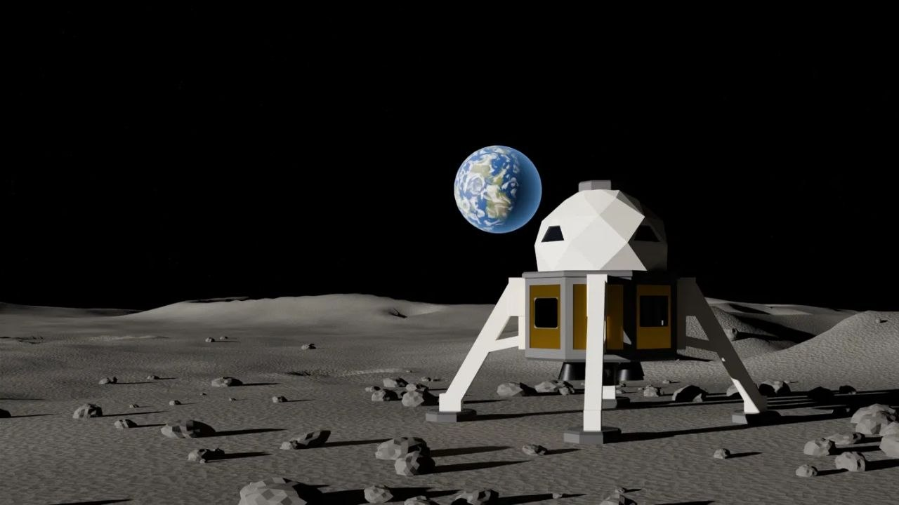
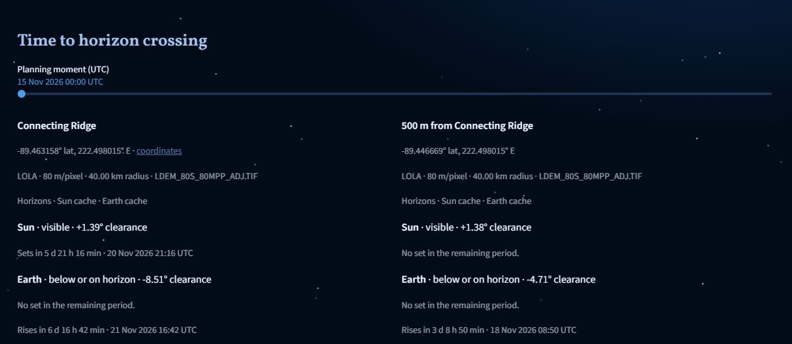
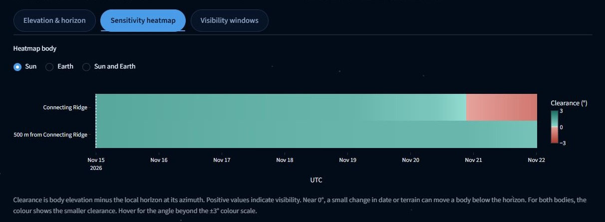
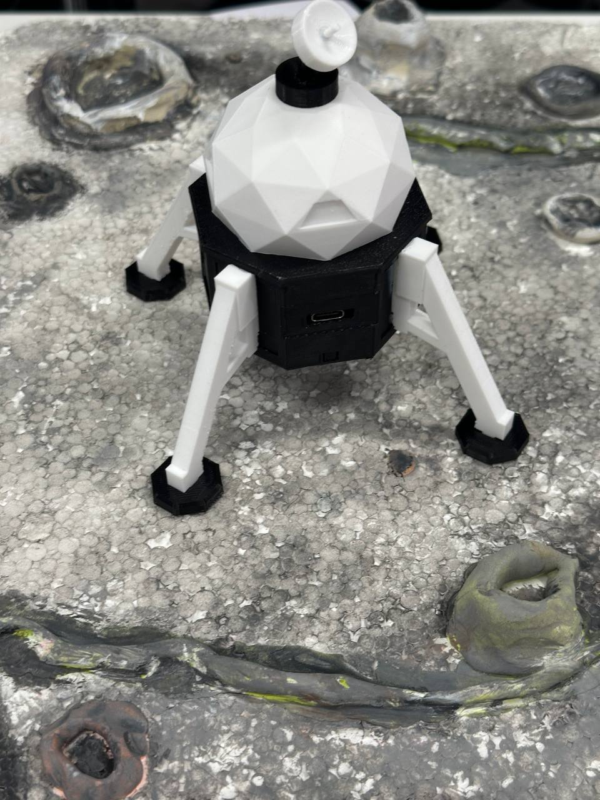

# SafeLanding AI

**Compare lunar landing sites by sunlight and direct visibility of Earth.**

SafeLanding AI combines NASA/JPL ephemerides with lunar terrain to help choose where and when to land. Built for the [Lunar Landing Site Navigator](https://www.spaceappschallenge.org/2026/challenges/lunar-landing-site-navigator/) challenge.

[Project video](#project-video) · [Planner screenshots](#planner-screenshots) · [Quick start](#quick-start)

## Project video

[](docs/media/project.mp4?raw=true)

[Open or download the project video (MP4, 30 seconds, 47 MiB)](docs/media/project.mp4?raw=true)

## Planner screenshots



*Sun and Earth horizon crossings for Connecting Ridge and a point 500 m to the north.*



*The date × site heatmap shows where small changes in location or time move the Sun below the terrain horizon.*

## What you can plan

- Compare up to four locations from Apollo, CLPS and other missions, or enter your own coordinates and add a nearby point.
- Set a custom UTC interval of up to 62 Earth days or use one or two mean lunar solar days.
- Scrub through a period to see time to the next set or rise, darkness intervals, direct Earth visibility and when both bodies are visible.
- Compare each body's elevation with the terrain horizon at its azimuth and inspect the angular clearance heatmap.

## Quick start

Run from the repository root in PowerShell.

```powershell
py -3.12 -m venv .venv
.\.venv\Scripts\Activate.ps1
python -m pip install -r frontend/requirements.txt
Set-Location frontend
python -m streamlit run app.py
```

Open [Streamlit](http://localhost:8501). Choose **Connecting Ridge**, enable a **500 m** comparison point, set **15–22 November 2026 UTC**, and select **LOLA where covered**. Click **Calculate visibility**, then open **Elevation & horizon**, **Sensitivity heatmap** or **Visibility windows**.

## Camera & AI



The **Camera & AI** tab supports camera capture, file uploads, and sample frames. For privacy reasons, this repository includes only part of the source code for the camera and AI features.

## Data and model

- Sun and Earth positions come from [NASA/JPL Horizons](https://ssd-api.jpl.nasa.gov/doc/horizons.html). Valid responses are cached for seven days in `.cache/horizons`. Set `SAFELANDING_HORIZONS_CACHE` to use another directory.
- The planner computes a terrain horizon from [NASA LOLA LDEM_80S_80MPP_ADJ](https://pgda.gsfc.nasa.gov/products/90) within 80–90°S. It samples lunar geodesics at 1° azimuth intervals for up to 40 km and accounts for lunar curvature. Outside the DEM coverage, the interface labels the horizon as a 0° tangent.
- To use a local lunar GeoTIFF in the MOON_ME frame, set `$env:SAFELANDING_LOLA_DEM = "C:\path\to\model.tif"` before starting the app. A local 5 m/pixel tile from [NASA PGDA](https://pgda.gsfc.nasa.gov/products/78) uses a radius of up to 4 km. Keep the filename `LDEM_80S_80MPP_ADJ.TIF` when using a local copy of the standard polar DEM.
- The planner interpolates horizon crossings for the centres of the Sun and Earth. Earth visibility estimates geometric line of sight. Solar panel output and radio links require separate models.
- The catalogue uses the lunar mean Earth/polar axis frame with east-positive longitude. [NASA Apollo Landing Sites](https://nssdc.gsfc.nasa.gov/planetary/lunar/lunar_sites.html), [NASA Lunar Spacecraft Coordinates](https://nssdc.gsfc.nasa.gov/planetary/lunar/lunar_artifact_impacts.html)

## FastAPI

Streamlit runs independently. For Swagger and HazardNet image analysis, install `requirements.txt` and run `.\run.ps1` or `./run.sh` from the repository root. HazardNet uses `training/best.pt` when the checkpoint is available.

| Endpoint | Returns |
| --- | --- |
| `GET /api/planner/sites` | Site catalogue with coordinate sources |
| `GET /api/planner/visibility` | Positions, terrain profile and visibility windows |
| `GET /api/sites/{site_id}/sun-earth` and `GET /api/compare` | Archived Site A/B scenarios |

For `/api/planner/visibility`, pass `site_id=connecting_ridge` or custom `lat` and `lon`, with UTC `start` and `end` values. Use `step_minutes` and `horizon=auto|flat` to set the sampling interval and horizon model.

## Tests

```powershell
python -m unittest discover -s tests -v
```
